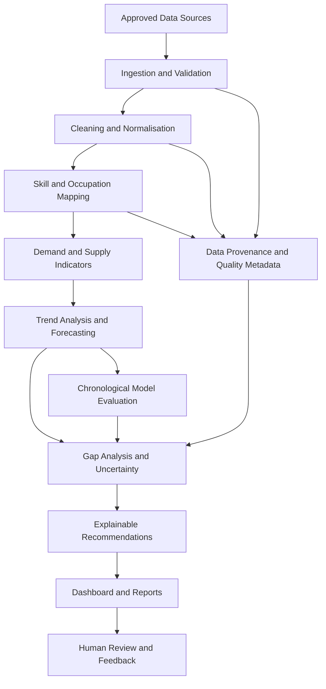

# SIH26246
# SkillSight
### AI-Powered Workforce Skill-Gap Intelligence and Planning

> **Predict the skill gap. Plan the skill pipeline.**

SkillSight is a proposed AI-enabled labour-market intelligence and decision-support system designed to help identify workforce skill gaps, understand how skill demand may change over time, and translate evidence into practical training and workforce-planning recommendations.

The project is framed around **SIH problem statement SIH26246**, associated with the **Ministry of Skill Development and Entrepreneurship (MSDE)**. Its central goal is to connect labour-market signals, occupational information, and available training data in a transparent workflow that helps planners make better-informed decisions.

> **Project status:** Concept / prototype development. The architecture and methods described below are a proposed implementation plan, not a claim that every component is already deployed or validated. Forecasts, coverage, and recommendations must be tested against real data before operational use.

---

## Table of Contents

- [The Problem](#the-problem)
- [Our Solution](#our-solution)
- [Who Can Use SkillSight?](#who-can-use-skillsight)
- [Key Objectives](#key-objectives)
- [Core Features](#core-features)
- [How SkillSight Works](#how-skillsight-works)
- [System Architecture](#system-architecture)
- [Data Strategy](#data-strategy)
- [AI and Analytical Methodology](#ai-and-analytical-methodology)
- [Recommendation Workflow](#recommendation-workflow)
- [Technology Stack](#technology-stack)
- [Proposed API Design](#proposed-api-design)
- [Evaluation Plan](#evaluation-plan)
- [Responsible AI, Limitations, and Risks](#responsible-ai-limitations-and-risks)
- [Getting Started](#getting-started)
- [Configuration](#configuration)
- [Suggested Repository Structure](#suggested-repository-structure)
- [Development Roadmap](#development-roadmap)
- [Expected Impact](#expected-impact)
- [Contributing](#contributing)
- [Team and Acknowledgements](#team-and-acknowledgements)
- [Disclaimer](#disclaimer)

---

## The Problem

Labour markets change as industries adopt new technologies, business needs evolve, and new occupations emerge. Education and training programmes may not adapt at the same speed. As a result, a region or sector can experience a mismatch between:

- The skills employers need.
- The skills workers currently possess.
- The skills taught by available education and training programmes.
- The skills likely to be required in the future.

This mismatch can make it difficult for policymakers, training providers, institutions, and workforce planners to decide **which skills to prioritise, where to focus training, and when to intervene**.

### Why is this difficult?

1. **Fragmented evidence:** Labour-market, occupation, employment, and training information may be stored in separate datasets and use inconsistent labels.
2. **Changing demand:** A skill that is in demand today may not have the same demand in the future.
3. **Inconsistent skill terminology:** Similar skills may be described using different names across job postings, occupational classifications, and course catalogues.
4. **Uneven data coverage:** Some occupations, regions, or sectors may have limited or outdated observations.
5. **Forecast uncertainty:** Predictions can be unreliable when data is sparse, trends change abruptly, or available data represents only part of the labour market.
6. **Limited actionability:** A chart showing a shortage is not enough; planners need evidence-based options for what to do next.

SkillSight addresses these challenges through a structured, explainable workflow rather than relying on a single prediction model.

---

## Our Solution

SkillSight is designed as an **uncertainty-aware workforce intelligence platform**. It brings compatible data sources into a common analytical pipeline, maps skills to occupational categories, analyses demand and supply signals, and presents potential gaps with supporting evidence and confidence information.

The system is intended to help users answer questions such as:

- Which occupations or skills show signs of a current mismatch?
- Which skills may become more important over a selected planning horizon?
- Which regions or sectors need closer investigation?
- What evidence supports a predicted shortage or surplus?
- How complete and reliable is the available evidence?
- Which training or upskilling options should be considered by a human planner?

SkillSight is a **decision-support tool**, not an automated authority on employment policy. Its recommendations should be reviewed by domain experts and interpreted alongside local context.

---

## Who Can Use SkillSight?

| User group | Potential use |
|---|---|
| Government and workforce planners | Identify potential skill mismatches and prioritise further investigation. |
| Skill-development authorities | Compare occupational demand signals with available training coverage. |
| Training providers and educational institutions | Review which competencies may need greater emphasis in curricula. |
| Sector skill councils and industry bodies | Analyse skill trends within selected sectors and occupations. |
| Researchers and policy analysts | Explore data coverage, trends, forecast uncertainty, and evidence gaps. |
| Regional development organisations | Compare available indicators across regions where comparable data exists. |

Access to data and the exact analytical features available will depend on the deployed version and the permissions of each user.

---

## Key Objectives

1. **Integrate evidence:** Bring together relevant labour-market, occupational, and training information where access and licensing permit.
2. **Standardise skill terminology:** Map different skill names to a consistent occupational and skill taxonomy.
3. **Identify potential gaps:** Compare demand and supply proxies while documenting how each measure is defined.
4. **Analyse trends:** Establish historical baselines and estimate future trends where sufficient time-series data exists.
5. **Communicate uncertainty:** Show confidence, data coverage, freshness, and limitations alongside analytical outputs.
6. **Support action:** Convert findings into reviewable training and planning options.
7. **Enable validation:** Measure model performance on held-out data before relying on forecasts for decisions.

---

## Core Features

The following are planned capabilities. Their implementation status should be updated as development progresses.

### 1. Labour-Market Data Integration

- Import supported datasets from approved sources.
- Validate schemas, data types, date fields, and missing values.
- Standardise occupation, region, sector, and skill identifiers where possible.
- Track source metadata, update dates, and data coverage.
- Preserve source-level provenance so results can be traced to the underlying evidence.

### 2. Skill and Occupation Mapping

- Normalise skill names and common variants.
- Map occupation labels to a consistent classification, such as the National Classification of Occupations (NCO), where appropriate.
- Use taxonomy rules and semantic similarity to suggest possible matches.
- Flag ambiguous or low-confidence mappings for human review instead of silently treating them as correct.

### 3. Skill-Gap Analysis

- Compare clearly defined indicators of demand and supply.
- Analyse gaps by occupation, skill, region, or sector when the underlying data supports the comparison.
- Distinguish observed values from estimated or inferred values.
- Display the period, unit, source coverage, and assumptions behind each indicator.

**Important:** Job-posting counts, employment counts, training enrolments, and worker skill inventories measure different things. They must not be treated as interchangeable measures of demand or supply. The implementation must define compatible indicators before calculating a gap.

### 4. Trend Analysis and Forecasting

- Establish simple baselines before introducing more complex forecasting models.
- Forecast only for occupations, skills, and time periods with adequate historical observations.
- Compare candidate models using chronological holdout evaluation.
- Report forecast intervals or other uncertainty estimates when the method supports them.
- Mark sparse, unstable, or out-of-distribution cases for cautious interpretation.

### 5. Evidence-Aware Dashboard

A planned dashboard may include:

- High-level indicators and data freshness.
- Skill and occupation trend charts.
- Filters for available regions, sectors, and planning periods.
- Demand/supply comparison views.
- Forecasts with uncertainty ranges.
- Data coverage and source-quality indicators.
- Explanations of the factors behind a finding.
- Downloadable summaries for analysis and review.

### 6. Training and Planning Recommendations

- Highlight skills and occupations that merit investigation.
- Link identified gaps to relevant training categories or course information when reliable mappings are available.
- Rank possible actions using transparent criteria, such as gap magnitude, trend direction, evidence quality, and training availability.
- Explain why each option is suggested.
- Require human review before recommendations are used for policy, funding, or programme decisions.

### 7. Optional Natural-Language Query Layer

A future extension could let users ask questions in plain language, such as:

> “Which occupations in this region show a growing demand signal, and how reliable is the evidence?”

A retrieval-augmented generation (RAG) layer could retrieve relevant records, definitions, reports, and methodology notes before generating a response. Answers should cite the underlying sources and clearly separate retrieved facts from model-generated interpretation. This component is optional and should not replace the core analytical pipeline.

---

## How SkillSight Works

The proposed workflow is divided into seven stages.

### Stage 1 — Data Ingestion

Collect approved, relevant datasets and record their source, time period, update date, licensing conditions, and available geographic or occupational coverage.

### Stage 2 — Data Quality and Normalisation

- Standardise column names, date formats, identifiers, and units.
- Detect duplicates and invalid values.
- Profile missingness and inconsistent categories.
- Keep a record of transformations.
- Avoid filling missing values without a documented justification.

### Stage 3 — Occupational and Skill Mapping

Map occupation and skill labels to common identifiers using taxonomy-based rules and, where useful, semantic similarity. Store mapping confidence and flag uncertain matches for review.

### Stage 4 — Demand and Supply Indicators

Construct comparable indicators from available evidence. Document the definition, denominator, unit, time period, and limitations of every indicator. Where direct supply data is unavailable, use a clearly labelled proxy rather than presenting it as a direct measurement.

### Stage 5 — Trend Analysis and Forecasting

Start with descriptive statistics and interpretable baselines. Evaluate candidate forecasting methods on time-ordered training and test periods. Produce forecasts only where the available data supports them.

### Stage 6 — Gap Interpretation and Recommendations

Combine gap indicators, trend direction, data coverage, and forecast uncertainty. Generate candidate actions with explanations, source references, and review flags.

### Stage 7 — Visualisation and Human Review

Present results in a dashboard or report. Users can inspect the evidence, understand uncertainty, and accept, revise, or reject suggested actions. Feedback can inform future improvements, subject to appropriate governance.

---

## System Architecture



### Architecture components

| Component | Responsibility |
|---|---|
| Data ingestion layer | Load permitted datasets and retain source metadata. |
| Data processing layer | Clean, validate, standardise, and transform records. |
| Taxonomy and matching layer | Map skill and occupation terminology to consistent identifiers. |
| Analytics layer | Calculate indicators and analyse historical trends. |
| Forecasting layer | Generate and evaluate forecasts where the data is sufficient. |
| Gap and recommendation layer | Interpret indicators, uncertainty, and possible interventions. |
| API layer | Expose approved analytical outputs to the user interface. |
| Dashboard layer | Display findings, filters, source coverage, and explanations. |
| Evaluation and governance layer | Track performance, data quality, assumptions, and human review. |

---

## Data Strategy

SkillSight is intended to use **authorised, documented, and relevant data**. Candidate sources may include:

- **Periodic Labour Force Survey (PLFS):** Employment and labour-force indicators, subject to the available tables, definitions, and survey periods.
- **National Career Service (NCS):** Available job and career-service information, subject to access, terms, and coverage.
- **National Classification of Occupations (NCO):** Occupational classification and related reference information for mapping occupations.
- **Training and education datasets:** Approved information on courses, enrolments, completions, certifications, or training capacity where accessible.
- **Other official or industry datasets:** Used only when provenance, licensing, coverage, and methodology can be documented.

These are candidate sources, not a claim that every source has already been integrated. Actual use depends on availability, access rights, data format, and whether the fields are suitable for the intended analysis.

### Data preparation principles

1. Record the source and observation period for each dataset.
2. Keep definitions and units consistent before comparing values.
3. Distinguish missing values from measured zeros.
4. Document proxies and assumptions explicitly.
5. Check whether geographic and occupational categories are comparable.
6. Avoid inferring individual-level skills from aggregate statistics.
7. Respect source licensing, privacy requirements, and applicable data-protection rules.

### Data coverage and quality

Each result should ideally expose:

- Source and last-updated date.
- Observation period.
- Coverage by region, sector, and occupation.
- Missingness and mapping confidence.
- Whether the value is observed, derived, or forecast.
- Relevant assumptions and known limitations.

If reliable supply-side data is unavailable, SkillSight should report that limitation rather than manufacture a precise supply estimate.

---

## AI and Analytical Methodology

SkillSight should use the simplest method that can be validated for a given task. A larger collection of AI models does not automatically make a forecast more accurate or useful.

### 1. Descriptive and exploratory analysis

Use summary statistics, time-series plots, distribution checks, missing-value analysis, and comparisons across available categories to understand the dataset before modelling.

### 2. Taxonomy-based mapping and semantic matching

Use known occupational classifications and rule-based normalisation first. Sentence embeddings may be used to identify potentially similar skill descriptions, but similarity is a suggestion—not proof that two skills are equivalent. Store confidence scores and route uncertain mappings for review.

### 3. Baseline-first forecasting

Candidate methods may include:

- Naive or seasonal-naive baselines, where appropriate.
- Moving averages or other simple trend baselines.
- Statistical time-series models, such as exponential smoothing or ARIMA-family methods, when their assumptions are reasonable.
- More complex models only when data volume, evaluation results, and practical value justify them.

Prophet or other forecasting libraries may be evaluated as candidates; they should not be assumed to be the best model for every dataset.

### 4. Chronological validation

For time-dependent data, split data by time rather than randomly. Train on earlier observations and evaluate on later, unseen periods. Where enough observations exist, use rolling-origin or walk-forward evaluation.

Possible metrics include:

- **MAE (Mean Absolute Error):** Average absolute prediction error.
- **RMSE (Root Mean Squared Error):** Gives greater weight to large errors.
- **WAPE (Weighted Absolute Percentage Error):** Can help compare aggregate errors when its denominator is meaningful and non-zero.
- **Baseline improvement:** Measures whether the candidate model outperforms a simple reference method.

No metric is appropriate in every case. For example, percentage-based metrics can behave poorly when actual values are zero or close to zero. Metrics and results should be reported with their evaluation period and data coverage.

### 5. Uncertainty and confidence

SkillSight should communicate several distinct concepts instead of collapsing them into one unexplained score:

- **Forecast uncertainty:** How much the future estimate may vary.
- **Data coverage:** How much relevant evidence is available.
- **Mapping confidence:** How certain the system is about a skill or occupation match.
- **Evidence quality:** Whether the sources are timely, consistent, and appropriate.
- **Recommendation priority:** A decision-support ranking based on documented criteria, not a probability of success.

Forecast intervals should be calibrated and evaluated where feasible. Low data coverage or poor validation performance should trigger warnings or suppress a forecast.

### 6. Recommendation logic

Recommendations should be traceable to observable indicators and documented rules. A recommendation might prioritise further review when a skill has a rising demand signal, limited corresponding training coverage, and sufficient evidence. The system should not claim that a shortage exists merely because one dataset contains many job postings.

### 7. Optional retrieval-augmented generation

If implemented, a RAG component may retrieve official definitions, source records, methodology notes, and relevant training information. It should:

- Ground answers in retrieved evidence.
- Provide source references.
- State when the evidence is insufficient.
- Avoid inventing values or citations.
- Keep generative explanations separate from validated numerical calculations.

---

## Recommendation Workflow

A suggested recommendation should include the following information:

| Field | Purpose |
|---|---|
| Skill or occupation | Identifies the subject of the finding. |
| Region or sector | Defines the context, when available. |
| Observed indicator | Shows the measured or derived evidence. |
| Trend or forecast | Describes historical movement or a model estimate. |
| Evidence coverage | Indicates how much relevant data is available. |
| Uncertainty or confidence | Communicates the limits of the estimate or mapping. |
| Suggested action | Proposes a reviewable training or planning option. |
| Explanation | States why the option was surfaced. |
| Sources and period | Enables verification and reproducibility. |
| Review status | Records whether a qualified person accepted, revised, or rejected it. |

A practical priority score may be introduced only after its components, weights, and limitations are documented. It must not be presented as an objective measure of social or economic impact without validation.

---

## Technology Stack

The following is a **proposed stack**, not a claim that every technology has already been integrated.

| Layer | Candidate technology | Purpose |
|---|---|---|
| Data processing | Python, Pandas, NumPy | Data cleaning, transformation, and analysis. |
| Forecasting | Statsmodels; Prophet as an evaluated option | Statistical modelling and time-series experiments. |
| Semantic mapping | Sentence-Transformers | Suggesting candidate matches between skill descriptions. |
| Backend API | FastAPI | Serving analytical results and metadata. |
| Database | PostgreSQL | Storing structured records, mappings, results, and provenance. |
| Frontend | React | Building an interactive dashboard. |
| Visualisation | A suitable React charting library; Leaflet for geographic views if needed | Presenting trends, comparisons, and supported regional data. |
| Optional retrieval | Embedding model and vector store | Searching methodology documents and relevant evidence for grounded answers. |
| Version control | Git and GitHub | Collaboration, change tracking, and documentation. |

The final stack should be selected according to implementation requirements, deployment constraints, team capability, and the actual data available. A prototype does not need every optional component.

---

## Proposed API Design

These endpoints illustrate a possible API contract. They are **design examples**, not confirmation that the endpoints already exist.

| Method | Endpoint | Purpose |
|---|---|---|
| `GET` | `/health` | Check service availability. |
| `GET` | `/api/v1/metadata` | List available sources, periods, and coverage metadata. |
| `GET` | `/api/v1/occupations` | Retrieve supported occupational categories. |
| `GET` | `/api/v1/skills` | Retrieve supported skill categories and mappings. |
| `GET` | `/api/v1/gaps` | Retrieve gap indicators with filters and provenance. |
| `GET` | `/api/v1/trends` | Retrieve historical trends and supported forecasts. |
| `GET` | `/api/v1/recommendations` | Retrieve candidate planning recommendations and explanations. |

API responses should include definitions, units, time periods, provenance, and uncertainty fields wherever applicable. Input validation, access controls, rate limiting, and safe error handling should be implemented before public deployment.

---

## Evaluation Plan

SkillSight must be evaluated on both analytical quality and practical usefulness.

### Forecast evaluation

1. Define the target variable and forecasting horizon.
2. Establish a simple baseline.
3. Use time-ordered training and test periods.
4. Compare candidate models on the same held-out observations.
5. Report metrics, coverage, and uncertainty.
6. Inspect performance across supported occupations, regions, or sectors.
7. Document where the model performs poorly or cannot produce a reliable estimate.

### Mapping evaluation

- Create a reviewed sample of skill and occupation matches.
- Measure precision and recall where labels support those metrics.
- Inspect false matches, ambiguous terms, and taxonomy coverage.
- Compare automated suggestions with human-reviewed mappings.

### Recommendation evaluation

- Ask domain reviewers to assess relevance, evidence quality, clarity, and actionability.
- Check whether every recommendation can be traced to a source and calculation.
- Record acceptance, revision, and rejection reasons during a pilot.
- Evaluate whether the system improves planning workflows rather than assuming that generated recommendations create impact.

### Reporting results honestly

Do not publish fabricated accuracy values, model improvements, coverage percentages, or impact statistics. Report actual results only after running reproducible experiments on documented data. Include the dataset version, evaluation dates, metric definitions, and baseline comparison.

---

## Responsible AI, Limitations, and Risks

### Data bias and incomplete coverage

Job postings may overrepresent certain employers, occupations, digital channels, or locations. Survey data may use different time periods and definitions from job or training data. These sources should be triangulated where possible, and their limitations should remain visible.

### Correlation is not causation

A rise in job-posting counts does not necessarily prove a shortage, and a low training count does not automatically mean training capacity is inadequate. Findings must be interpreted in context.

### Forecast uncertainty

Unexpected economic changes, policy shifts, technological developments, and changes in data collection can invalidate historical patterns. Forecasts must be monitored and periodically reassessed.

### Taxonomy mismatch

Similar skill descriptions may represent different proficiency levels or tasks. Automated semantic matching should support, not replace, expert review.

### Privacy and security

Use authorised datasets, minimise personal data, apply access controls, and follow applicable privacy and security requirements. Prefer aggregate analysis when individual-level records are unnecessary.

### Human oversight

SkillSight should support qualified planners, not automatically determine funding, admissions, employment eligibility, or access to training. Significant decisions require human review and documented reasoning.

### Interpretability and auditability

Users should be able to inspect the source, calculation, time period, assumptions, and uncertainty behind important outputs. Model versions and data transformations should be recorded.

---

## Getting Started

The exact setup depends on the code currently present in the repository. The steps below describe a suggested Python API and frontend workflow; adjust commands to match the implemented project structure.

### Prerequisites

- Python 3.10 or a compatible version supported by the chosen dependencies.
- Node.js and npm if a React frontend is included.
- Git.
- Access to the datasets required for the selected experiment.

### 1. Clone the repository

```bash
git clone https://github.com/<your-username>/SkillSight.git
cd SkillSight
```

Replace `<your-username>` and the repository name with the actual GitHub details.

### 2. Create a Python environment

```bash
python -m venv .venv
```

Activate it:

**Windows PowerShell**
```powershell
.venv\Scripts\Activate.ps1
```

**Windows Command Prompt**
```bat
.venv\Scripts\activate.bat
```

**macOS / Linux**
```bash
source .venv/bin/activate
```

### 3. Install backend dependencies

Once a `requirements.txt` has been committed:

```bash
pip install -r requirements.txt
```

If the dependency file has not yet been created, add and test the project's actual dependencies before asking contributors to install them.

### 4. Configure environment variables

Create a local `.env` file based on a committed `.env.example`, if the project uses environment variables. Do not commit secrets, credentials, private data, or production connection strings.

### 5. Run the API

For a FastAPI application whose entry point is `app.main:app`, the example command is:

```bash
uvicorn app.main:app --reload
```

This command must be adjusted if the actual entry point differs. If enabled, the interactive API documentation is commonly available at `/docs`.

### 6. Run the frontend

If the frontend is in a `frontend/` directory and contains a valid `package.json`:

```bash
cd frontend
npm install
npm run dev
```

Follow the URL printed by the frontend development server.

### 7. Prepare data and run an experiment

- Obtain permitted datasets from their documented sources.
- Place local data in the configured data directory, not in public version control unless redistribution is allowed.
- Run the project's actual preprocessing and evaluation scripts.
- Verify outputs against the documented schema and sample checks.
- Record model configuration, dataset period, and evaluation results.

**Note:** The commands above are templates for the proposed architecture. They are not guaranteed to run until the corresponding files, dependencies, and scripts exist in the repository.

---

## Configuration

A future `.env.example` may include settings such as:

```dotenv
APP_ENV=development
API_HOST=127.0.0.1
API_PORT=8000

# Configure only if PostgreSQL is used.
DATABASE_URL=

# Configure only if the selected data source requires credentials.
DATA_SOURCE_API_KEY=

# Optional: configure only if an external language model is integrated.
LLM_API_KEY=
```

Keep actual credentials in local environment variables or a secrets manager. Never commit real API keys. Remove configuration entries that the implementation does not use.

---

## Suggested Repository Structure

The following layout separates data processing, modelling, API services, and the user interface. It can be adapted to the codebase.

```text
SkillSight/
├── README.md
├── LICENSE
├── .gitignore
├── .env.example
├── docs/
│   ├── architecture.md
│   ├── data-dictionary.md
│   ├── methodology.md
│   └── evaluation.md
├── data/
│   ├── README.md
│   └── samples/
├── notebooks/
│   └── exploratory-analysis.ipynb
├── backend/
│   ├── app/
│   │   ├── main.py
│   │   ├── api/
│   │   ├── services/
│   │   ├── schemas/
│   │   └── core/
│   ├── tests/
│   └── requirements.txt
├── analytics/
│   ├── ingestion/
│   ├── preprocessing/
│   ├── taxonomy/
│   ├── indicators/
│   ├── forecasting/
│   ├── gap_analysis/
│   └── evaluation/
└── frontend/
    ├── package.json
    └── src/
```

Only retain directories and files that are relevant to the real project. A smaller, working repository is preferable to an impressive-looking structure full of empty folders.

---

## Development Roadmap

### Phase 1 — Data and problem definition
- Finalise the analytical questions and target indicators.
- Identify accessible datasets and document their licensing.
- Define units, periods, and compatible demand/supply measures.
- Build data-quality checks and a reproducible baseline analysis.

### Phase 2 — Skill mapping and gap analysis
- Establish occupation and skill mappings.
- Review ambiguous mappings.
- Calculate transparent indicators on a limited, well-defined scope.
- Add provenance and coverage information to outputs.

### Phase 3 — Forecasting and validation
- Build a baseline forecast.
- Compare suitable candidate models using chronological evaluation.
- Report uncertainty and failure cases.
- Exclude unsupported forecasts from decision-facing outputs.

### Phase 4 — Dashboard and API
- Expose validated analytical results through an API.
- Build filters, trend charts, and evidence details.
- Display source, period, coverage, and uncertainty alongside results.

### Phase 5 — Recommendations and pilot review
- Generate candidate actions using documented rules.
- Conduct expert review and record feedback.
- Evaluate usefulness and limitations before expanding scope.

### Phase 6 — Deployment and monitoring
- Add authentication and role-based access where required.
- Set up automated tests, logging, and data/model version tracking.
- Monitor source freshness and model performance.
- Document operational requirements before wider deployment.

---

## Expected Impact

If implemented and validated successfully, SkillSight could help stakeholders:

- Identify potential workforce mismatches earlier.
- Compare labour-market signals with available training information.
- Prioritise further research and training-planning discussions.
- Improve transparency about the evidence behind decisions.
- Direct attention toward occupations, skills, or regions that need investigation.
- Reduce reliance on disconnected spreadsheets and untraceable assumptions.

These are **expected benefits**, not measured outcomes. Actual impact will depend on data quality, model validity, adoption, and the quality of human decision-making around the results.

---

## Contributing

Contributions that improve data quality, reproducibility, model evaluation, usability, accessibility, or documentation are welcome.

Suggested workflow:

1. Open an issue describing the problem or proposed improvement.
2. Discuss changes that affect data definitions, evaluation methodology, or architecture before implementing them.
3. Create a feature branch.
4. Add tests or reproducible evidence for analytical changes.
5. Update documentation when data schemas, assumptions, or API contracts change.
6. Submit a pull request with a concise summary and testing notes.

Do not contribute datasets unless their source, licence, and redistribution permissions are clear. Do not include personal, confidential, or credential-bearing information.

---

## Team and Acknowledgements

**Project:** SkillSight  
**Challenge context:** Smart India Hackathon (SIH), problem statement SIH26246  
**Associated ministry:** Ministry of Skill Development and Entrepreneurship (MSDE)

Add verified team member names, institution, mentor details, and official challenge links here. Confirm the exact problem-statement title and all official identifiers against the SIH listing before publication.

---

## Disclaimer

SkillSight is a workforce-intelligence and planning-support project. Its outputs are only as reliable as the data, definitions, and methods behind them. Forecasts are estimates, not guarantees. Candidate recommendations require review and should not be treated as definitive evidence of a labour shortage or as automatic policy decisions.

The names of third-party datasets, libraries, and organisations are used for identification and documentation. Their inclusion does not imply endorsement or partnership.

---

## Project Tagline

**Predict the skill gap. Plan the skill pipeline.**
